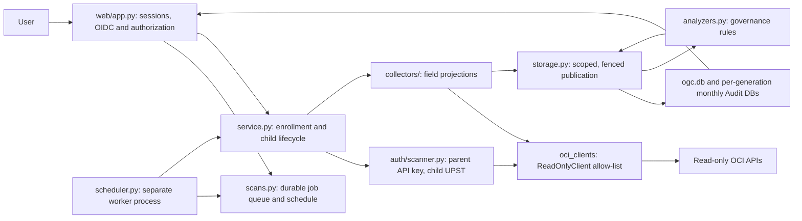

# OCI Governance Center — Architecture

Status: 2026-10-22, describing the new `oci_governance_center` implementation. Contracts are in
[AGENTS.md sections 6–7](../AGENTS.md#6-oci-integration--enrollment-application-access-and-scanner-trust);
capabilities and live release gates are in [implementation status](implementation/status.md).
[Collection](collection.md), [storage](storage.md), [control plane](control-plane.md) and
[audit recovery](delta-fetching.md) contain historical OSC design input. Where they conflict with
AGENTS.md or this page, AGENTS.md and this page win.

## 1. Boundaries and data flow

OGC governs and observes one OCI Organization. All OCI resource access is read-only. Local SQLite
writes, scanner token exchange and administrator-applied setup packages are separate operations.
No collector or analyzer may apply a policy or modify an OCI resource.

Collection runs only in the separate `ogc scheduler` process (or one-shot `ogc scan`). The web
process queues work and reads stored data; it never performs collection in a request. Each tenancy
scan constructs its own clients and signer. A bounded thread pool (`OGC_MAX_WORKERS`) limits
concurrent tenancies, and an expiring per-tenancy lease prevents overlapping runs. Analyzers use
only stored, complete batches.

## 2. Authorization and coverage

Human login is OAuth Code + PKCE against the parent default domain. Group membership comes from
Asserter, and only the parent's `ogc_admin` and `ogc_viewer` group IDs grant access. Membership is
rechecked at least every five minutes and before every configuration change. The scanner is
independent of login: the parent uses its API key directly, and children use API key → parent JWT →
child UPST (AGENTS.md §6.6). Admin routes require `ogc_admin`. Viewers can read dashboards,
coverage, findings, activity and exports. All checks are enforced server-side.

Every collected dataset is published under an explicit `Scope` (tenancy, dataset, region, domain,
compartment). A failed scope raises `OGC-ACCESS-002` and keeps the previous snapshot. Unknown is
never rendered as healthy or empty. Tier 1 shows observed IAM policy statements and group
membership; identity-domain admin-role grants arrive at Tier 4. OGC makes no complete
effective-permissions claim.

## 3. Read-only enforcement contract

- Only reviewed `get_*`, `list_*`, `summarize_*` and `search_*` SDK operations are permitted.
- SDK construction happens only in `oci_clients/__init__.py`. The OCI request signer and
  `SecurityTokenSigner` are constructed only in `auth/scanner.py`.
- Every client is wrapped in `ReadOnlyClient`, which exposes only its kind's operations from
  `OPERATIONS`. It hides the wrapped client and `base_client` and rejects attribute assignment.
- Raw HTTP is limited to `auth/scanner.py` (`requests`: domain token endpoint, `SigningCert/jwk`,
  OpenID discovery) and `auth/oidc.py` (`httpx`/Authlib: discovery, token, JWKS, Asserter).
  Redirects are disabled and endpoints are constrained to the saved identity-domain origin.

Enforcement: `tests/unit/test_sdk_boundary.py` statically checks the construction and HTTP sites
and requires the referenced operation names to equal the allow-list exactly. Receiver-specific
exemptions exist for local methods. `tests/unit/test_auth_and_boundary.py` exercises aliases,
`getattr`, wrapped-client access and real SDK construction without network access.

## 4. Required design versus current implementation

Do not mark a criterion complete based on documentation or mocked tests when it requires OCI
evidence. Live gates are listed in [implementation status](implementation/status.md).

| Area | Required contract | Current implementation |
|---|---|---|
| SDK enforcement | §3 | Implemented: per-kind allow-list, `ReadOnlyClient`, static and runtime bypass tests (mocked). |
| Scoped snapshots | Complete same-scope replacement; failures preserve data | Implemented in `Store.publish`: complete batches replace their scope and record diffs in `changes`; incomplete batches keep prior records and raise `OGC-ACCESS-002`. Fenced by generation, pending cleanup, scanner suspension, child revision/pause/departure and lease. Duplicate keys within one batch fail the transaction rather than being rejected explicitly. |
| Finding identity and lifecycle | Source-specific versioned identity; scoped resolution; `resolved_at` | Implemented: governance IDs hash `["v1", tenancy, dataset, record key, rule]`; coverage IDs hash `coverage-v1:` + scope. `first_seen` is retained; resolution requires a complete batch for the same scope. Every writer builds a `models.Finding` (source, severity and status limited to AGENTS.md §5 values), and `Store.rows("findings")` revalidates stored rows, so a malformed row fails loudly rather than rendering. |
| Audit durability | Events durable before checkpoint; gap-aware | Partial: `Store.audit_commit` writes event files, then the receipt and checkpoint, inside one fenced transaction. Three cursors per region: forward catches up to the present each scan (15-minute overlap); reconciliation re-reads the 24 hours before the previous forward checkpoint; backfill reads up to `OGC_AUDIT_BACKFILL_HOURS` per scan toward a fixed target where forward collection began. Not implemented: explicit gap ledger, split-until-proven, lost-file rebuild and replay older than 24 hours. |
| Organization replacement | Fenced, recoverable switch and cleanup (AGENTS.md §6.8) | Implemented: `Store.install` atomically clears organization tables, advances the generation and records pending cleanup. Cleanup of old Audit, backup and export directories retries on startup, and all writes are fenced until it finishes. Same-parent key repair advances the generation and interrupts running jobs. No separate drain or maintenance mode. |
| Scan control | AGENTS.md §6.9, [scanning](scanning.md) | Implemented: durable queue, coalescing, daily/weekly schedule with DST rules, heartbeat, renewable job leases, interrupted-run recovery. |
| Child trust (WIF) | AGENTS.md §6.5–6.6 | Implemented with mocks: per-worker exchange, identity rebinding on renewal, revision fencing. Live caller authorization is release gate 1. |
| Storage migrations | Explicit versioned migrations | Not implemented: the schema is created with `CREATE TABLE IF NOT EXISTS` only (see §5). |
| Backup and restore | Complete manifest and recovery | Not implemented. Replacement removes the managed backup/export directories. |
| Tier 2 guardrails | collection §4 | Not implemented. |
| Tier 4 policy analysis | Policy-local aliases, parser, risky-grant rules | Implemented (mocked tests): tolerant parser (`analyzers/policy.py`) and POL-*/IAM-* rules (`analyzers/identity.py`) persisted as findings in four fail-closed scopes (`analysis.policy`, `.identity`, `.api_keys`, `.activity`); an incomplete input publishes the scope as incomplete and resolves nothing. Alias definitions are recorded (POL-XTEN-001) but aliases are not yet substituted. Admin-role grants are not collected. |
| Tier 5 anomalies | collection §7 | Not implemented; Audit events are stored for later use. |

## 5. Document ownership

- [IAM catalog](iam/README.md) owns permission intent. Rendering lives only in
  `provisioning/bundle.py`; do not add a second renderer.
- [Detection catalog](detections/README.md) lists implemented and planned rules and their specs.
- Changing an existing table requires an explicit migration with backup and recovery guidance.
  `CREATE TABLE IF NOT EXISTS` is not a migration mechanism.
- No live OCI test, CLI command or scan is authorized by this document. Sandbox evidence needs the
  user's explicit session authorization and a named tenancy/profile.
