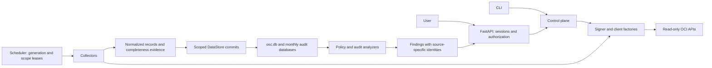

# OCI Security Center — Architecture

Status: Design baseline, 2026-10-08; implementation status updated 2026-10-09 (all contracts in §4
implemented with mocked tests; live OCI evidence still required). Implementation status below is
authoritative for this revision.
Read with [AGENTS.md](../AGENTS.md), [control plane](control-plane.md),
[collection](collection.md), [storage](storage.md), and [audit recovery](delta-fetching.md).

## 1. Boundaries and data flow

OSC governs and observes one OCI Organization. All OCI resource access is read-only; local SQLite
writes, authentication token exchange, and human-run policy commands are separate operations.
No collector or analyzer may apply a policy or modify an OCI resource.

Tier 1 collectors, the scan runner, the audit ingestion coordinator and the scheduler are
implemented (`collection/`, `collectors/`); Tier 2–5 collectors and analyzers, including anomaly
rules, are not yet built. The scheduler runs as its own process (`osc scheduler`, plus one-shot
`osc scan`), not inside the web server; the web UI only reads data (decision 2026-10-09). The diagram is the required design, not a statement
that every component exists. OCI clients are created per worker; analyzers use only
stored data. A bounded pool limits active work, with per-scope leases preventing overlapping runs.

## 2. Authorization and coverage

The parent has separate interactive admin and non-interactive scan connections. Children have no
credentials. The scan identity reaches children through paired Endorse/Admit policies. Admin routes
require OSC-Admins; viewers can read findings, policy review, audit views and exports. All sensitive
reads and local changes are authorized server-side. CLI operations require trusted host access.

Access-policy checks establish configured grants; smoke tests establish access to the specific APIs
and regions tested. Neither is proof of complete inventory. Every dashboard must show collection tier,
last successful collection, scope, and any unsupported, stale, failed or partial coverage. Unknown is
never rendered as healthy or empty. Tier 1 displays observed IAM policy grants and group membership;
identity-domain administrator grants are included only from Tier 4. OSC does not promise a complete
OCI effective-permissions evaluator (conditions, resource policies and service-specific authorization).

## 3. Read-only enforcement contract

The existing AST test is a deny-list and is only a supplementary guard. Before production release,
enforce an explicit SDK operation allow-list at the client boundary and test the static call surface:

- Inventory every SDK operation used by collectors and control-plane services; only reviewed
  `get_*`, `list_*`, `summarize_*`, and `search_*` operations are permitted.
- SDK constructors, pagination helpers and signer token exchange are infrastructure operations,
  separately reviewed; authentication may issue credentials but may not mutate tenancy resources.
- Wrap SDK clients so operation attributes are checked before invocation. Reject unknown operations,
  dynamic method lookup, and indirect aliases unless they go through this same boundary. Static
  checks must identify SDK receivers; local storage method exemptions are receiver-specific.
- Raw HTTP access is limited to reviewed OIDC discovery, JWKS, userinfo and token endpoints.
  No raw HTTP resource API calls, SDK bypasses, or arbitrary base-client operations are allowed.
- Test an allowed read, an unfamiliar mutating verb, a method alias, `getattr`, a colliding local-method
  name and an attempted raw HTTP bypass. The test suite makes no live OCI calls.

Production release requires this enforcement; passing the current deny-list test alone is insufficient.

Implementation (2026-10-09): `oci_clients/allowlist.py` lists reviewed read operations per SDK client
class; `ClientFactory` refuses unlisted client classes before constructing them and wraps every client
in `ReadOnlyClient`, which exposes only those operations (no other attributes, no assignment).
`tests/unit/test_sdk_boundary.py` checks `src/` statically (SDK operation names against the allow-list
with file+receiver exemptions for colliding local methods; SDK construction only in the client and
signer factories; no `base_client`/`call_api`/wrapped-client internals or `__dict__` dispatch; dynamic
`getattr` only at reviewed sites; raw HTTP only for OIDC token refresh and userinfo; OIDC discovery,
token and JWKS calls only through authlib in `web/app.py`) and exercises each required bypass shape.
The allow-list must equal the operations actually used. Signer construction (instance principal,
token exchange) remains reviewed infrastructure in `auth/signers.py`.

## 4. Review closure and acceptance criteria

The design decisions below close the 2026-10-08 review. Runtime changes are still required where shown;
this documentation revision does not certify that those changes or live POCs have been completed.

| Gap | Required contract | Current implementation / release acceptance |
|---|---|---|
| Policy alias leakage | Control plane §5.3: definitions scoped to one policy | Implemented: `DefineTable` per policy document, conflicting definitions → unknown; tests cover split definitions, conflicts, alias reuse across policies and complete same-policy blocks. |
| Finding collisions | Storage §3.4: versioned source-specific identity | Schema v2 implements identity v1 (structured, per-source components, Cloud Guard/Security Zone shared namespace), scoped resolution, reopen and `resolved_at`; v0.1 rows migrate or are quarantined. Collector-emitted identities arrive with their collectors. |
| Snapshot scope | Storage §4.1: declared scope and complete manifest | Schema v2 implements registry-declared scopes, complete-manifest publication, scope-only removal, out-of-scope/duplicate rejection, lease and generation fencing and delayed-run rejection, with mocked tests. Collectors producing manifests are the next slices. |
| Audit durability | Delta-fetching §§2–4: durable events before checkpoint | Implemented: `collection/audit.py` + `commit_interval` (ledger, checkpoint, scan item in one durable fenced transaction after durable event batches); forward/backfill/reconcile cursors, split-until-proven, gaps, lost-file rebuild. Mocked tests cover crash between event and checkpoint commits, late events, month boundaries, gaps, paging and fencing. Source limits remain gate Q2. |
| Cross-tenancy capability | Collection §10 and control plane §2.6 | Capability status per (tenancy, dataset, scope) is recorded by every collection (`capabilities` table) and reset on scan-principal change; unshared audit regions are coverage gaps. Domain auth/member paging and regional behaviour still need authorized sandbox evidence (Q1, Q5). |
| Vault bootstrap / signer compatibility | Control plane §3.1: no credential dependency cycle; §2.3: supported signer/deployment pairs | Implemented: `auth/policy.py` (one rule set for CLI, web and signers); `oci` mode rejects CLI-profile and API-key connections; Vault-backed API-key scan and Vault refs without a keyless scan identity are rejected in preflight before anything is stored or replaced. |
| Organization switch | Control plane §6.1: exclusive lease and generation fencing | Implemented: full preflight, drain with timeout, `switch_journal` (prepared → committed → active → cleaned), quarantine-then-activate, startup/`osc admin recover` recovery, generation-fenced control-plane and web writes, session generation, 503 for writes during maintenance. |
| Backup and restore | Storage §6.1: complete manifest and recovery | Implemented: `osc db backup|restore` (`storage/sqlite/backup.py`) with manifest, checksums, key verification, atomic publish, expiry, offline staged restore to a new generation, audit reconciliation and main-DB-only partial restore. Restore drills on real deployments remain an operational requirement. |
| Short-window anomalies | Collection §7: indexed event candidates and exact timestamps | Not started (Tier 5). Audit events are collected and stored per the contract; candidate indexes and analyzers come with Tier 5. |
| SDK enforcement | Architecture §3 | Implemented: per-client read allow-list, `ReadOnlyClient` runtime wrapper, static boundary and bypass tests (mocked; no live calls). New operations go through the allow-list review. |

Do not mark an acceptance criterion complete based on documentation or mocked tests when it requires
OCI evidence. Store only synthetic fixtures; do not record real credentials or token claims.

The subsequent implementation review found six local failure-path defects. Their fixes and
regression coverage are summarized in [Implementation review fixes](review-fixes.md).

## 5. Document ownership and implementation status

- [IAM catalog](iam/README.md) owns permission intent and validation status; policy rendering is in
  `control_plane/policy_templates.py`. Do not add a second independent renderer.
- [Detection catalog](detections/README.md) lists existing and planned rules and their specifications.
- Storage schema versions require explicit migrations, backed-up inputs and rollback/recovery guidance.
  `CREATE TABLE IF NOT EXISTS` is not a migration mechanism for changing an existing schema.
- No live OCI test, CLI command or scan is authorized by this document. Sandbox evidence needs the
  user's explicit session authorization and a named tenancy/profile.
