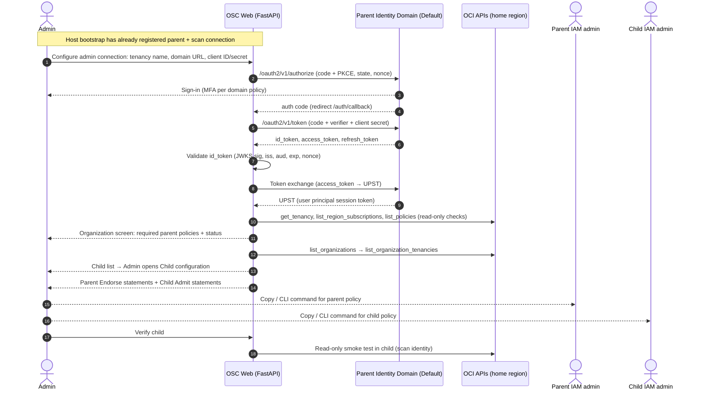

# Control Plane — Design

Status: **Design v0.4** (2026-10-08) · Owner: Kiran Thakkar
Scope: connecting the **parent tenancy**, discovering **child tenancies** from the OCI Organization, and
onboarding the children the admin selects. Read with `AGENTS.md` §2 (security principles) and §6.
Required contracts and current implementation gaps are tracked in [architecture §4](architecture.md).

### Decisions recorded (2026-10-07)
| # | Decision |
|---|----------|
| R1 | **Deployment: both.** Workstation for development/POC; target production on OCI Compute instance principal. Container Instance resource-principal support needs validated matching rules/authentication before release (§2.3). |
| R2 | **Users: small team, two roles.** `OSC-Admins` manage connections and onboarding; `OSC-Viewers` only see findings. |
| R3 | **Child access: cross-tenancy only.** One scanner group (or dynamic group) in the parent; every child applies Admit policies. No per-child credentials. |
| R4 | **The tool is strictly read-only (revised).** OSC never creates, updates or deletes anything in any tenancy, parent or child. It **shows** every policy it needs, with copy, download and CLI options, and **checks read-only** whether each one is in place. Humans apply them. *(Replaces the earlier "parent-side policy writer" decision.)* |
| R5 | **One organization per deployment** (2026-10-08). Replacement preflights the full configuration, drains work under an exclusive maintenance lease and advances a generation (§6.1). Previous active local data is removed and sessions end; the control-plane audit trail and retained backups follow their retention rules. Multi-organization support remains backlog. |

---

## 1. User flow

1. Admin opens **Admin → Organization configuration** in the web UI.
2. First-time host bootstrap registers the **parent tenancy** and a non-interactive scan connection.
   The authenticated admin can then configure a separate interactive admin connection:
   - **A. OIDC sign-in + token exchange** (interactive, recommended for admin use)
   - **B. OCI CLI settings** (an existing `~/.oci/config` profile: API-key or `security_token_file` profile)
   - **C. OCI user + API key** (workstation scan identity; locally encrypted key, §3.1)
3. The screen shows **all policies and prerequisites OSC needs in the parent tenancy** (§5.1), each with a
   live read-only status: ✅ detected · ❌ missing · ⚠️ can't check.
4. The tool authenticates and runs a read-only **connection test** (get tenancy, list region subscriptions).
5. The tool reads the **Organization** of the parent tenancy and lists its **child tenancies**.
6. Admin **picks a child to configure** and opens **Child configuration** (§5.2), which shows:
   - the **Endorse policy** the parent admin must add to the **parent** tenancy, and
   - the **Define/Admit policy** the child admin must add to the **child** tenancy.
   The child is marked `pending`.
7. When both are applied, admin clicks **Verify**. The tool runs a read-only smoke test in the child as the
   scan identity and moves it to `verified` → `active`, or `error` with the failing call and likely cause.



---

## 2. Corrections and constraints on the original idea

### 2.1 The tenant URL is not an OIDC endpoint
`https://cloud.oracle.com/?tenant=<name>&domain=Default` is the **Console sign-in page**. OIDC needs the
**identity domain URL** of the parent's Default domain:

```
https://idcs-<guid>.identity.oraclecloud.com
  /.well-known/openid-configuration   (discovery)
  /oauth2/v1/authorize, /oauth2/v1/token, /admin/v1/SigningCert/jwk
```

**Design:** the admin screen asks for **tenancy name** (display + Console deep link) **and the Default
domain URL** (Console → Identity & Security → Domains → Default → *Domain URL*). Everything else is loaded
from the discovery document.

### 2.2 Token exchange needs setup in the parent's identity domain
Exchanging the user's token for an OCI **UPST** needs:

- A **Confidential Integrated Application** in the Default domain: grant types **Authorization Code** and
  **Client Credentials**; redirect URL `https://<osc-host>/auth/callback`
  (dev: `http://localhost:8000/auth/callback`); group claims enabled; activated.
- An **Identity Propagation Trust** (type `JWT`) that trusts the domain's own issuer
  as verified from the actual token/discovery metadata, maps a verified subject claim to the matching
  identity-domain user attribute, has impersonation **disabled**, and lists our client ID as an allowed
  OAuth client. Never assume `sub` is a username. The issuer, JWKS URL, claim mapping and client
  restriction must pass an authorized POC; see [domain setup](iam/parent-domain-setup.md).

Use `oci.auth.signers.TokenExchangeSigner` (JWT or callable, domain ID, client ID, client secret). The UPST is
short-lived (about an hour) and gets re-exchanged when needed.

OSC **shows** these prerequisites on the Organization screen as a checklist with OCI CLI commands (§5.1).
It does not create them (R4).

### 2.3 Interactive tokens can't run background scans
A UPST belongs to a signed-in human and expires. Scheduled scans use a **scan identity**, chosen by
deployment mode:

| `OSC_DEPLOYMENT` | Scan identity | Admin sign-in |
|---|---|---|
| `workstation` | Method B (CLI profile) or C (service user + API key) in group `OSC-Scanners` | OIDC, **or** the CLI profile directly (single-user, localhost only) |
| `oci` | **Instance principal**, dynamic group `OSC-Scanner-DG` | OIDC only |

In `oci` mode, methods B and C are unsupported; `auth/policy.py` rejects both for scan and admin
connections in the CLI, the web forms and the signer factory. A future break-glass API-key mode needs an explicit design
for principal/group policy selection, secret retrieval and audit; deployment mode alone must not
select a dynamic-group policy for a service-user signer. Container resource-principal deployment
also needs validated matching rules and authentication evidence before it is advertised as supported.

### 2.4 Joining an Organization doesn't grant access to the child
Being the parent lets you **list** children, but gives no IAM access **inside** them. Each child needs the
Define/Admit statements from §5.2. The child list shows an onboarding status per child.

### 2.5 Group identity for Endorse/Admit
- The parent's `Endorse` uses the group **name**. Groups outside the Default domain are domain-qualified:
  `'<DomainName>'/'<GroupName>'`.
- The child's `Define group|dynamic-group` uses the group **OCID**. OSC resolves it read-only from the
  parent (`list_groups` / `list_dynamic_groups`, or the identity-domains API) so the statements are ready to
  paste.
- **D2 (open):** check in a POC whether a UPST is honored by Endorse/Admit. Child verify always uses the scan
  identity, so this only affects an optional "admins can browse children" block (§5.2, optional).

### 2.6 Region and API capability checks

Compare the parent and child's READY subscriptions before scheduling regional collectors. Record the
child home region, Cloud Guard reporting region and each audit region independently. Missing shared
subscriptions remain explicit coverage gaps; OSC never subscribes a region or silently reduces the
expected child region set. Parent IAM admins handle subscription changes manually.

Verify records the identity, API, region, time and outcome of every probe. Audit verification includes
the Logging Search path (or the complete per-compartment Audit fallback), not just a root
Audit request. Domain-user/group reads and member paging require their own capability evidence. A
basic onboarding smoke test may pass while dataset capabilities remain unsupported or partial; show
both states. Activation never turns a failed/untested scope into complete coverage. Recheck capabilities
when subscriptions, principal, policies or domain configuration change.

Oracle documents same-region subscriptions as a cross-tenancy prerequisite:
[Cross-Tenancy Access Policies](https://docs.oracle.com/en-us/iaas/Content/Identity/policieshow/iam-cross-domain.htm).

---

## 3. Connection methods — implementation notes

| | A. OIDC + token exchange | B. OCI CLI settings | C. User + API key |
|---|---|---|---|
| Input | tenancy name, domain URL, client ID, client secret | config file path, profile name | tenancy OCID, user OCID, fingerprint, region, key ref |
| Signer | `TokenExchangeSigner` | `oci.config.from_file` → `Signer` / `SecurityTokenSigner` | `oci.signer.Signer` |
| Secrets stored | client secret (encrypted / Vault) | **nothing** — only path + profile name | locally Fernet-encrypted key reference in v1 (§3.1) |
| Good for | admin UI, discovery and parent policy checks | workstation dev/POC | workstation scans with locally encrypted key |
| Not for | scheduled scans | `oci` deployment mode | interactive admin identity |

Per-child connections are **out of scope** (R3). Child verify always uses the scan connection.

### 3.1 Secret retrieval and bootstrap dependency

Vault references are supported only when an independently usable keyless scan identity (CLI profile,
instance or resource principal) can retrieve them. It must be available before resolving OIDC secrets.
The local encryption key must be injected externally at startup; fetching it may not depend on an
OSC connection encrypted by that same key.

For a workstation API-key scan identity, v1 uses a locally Fernet-encrypted key reference. Reject a
Vault-backed API-key scan connection before connection testing or organization replacement: the key
cannot authorize retrieval of itself. Replacing a keyless scan identity with an API-key identity also
requires converting its dependent OIDC Vault references to supported local references first, or the
change is rejected. Never resolve through an old organization's scan identity during replacement.

A future dedicated Vault retrieval identity is deferred and would require a reviewed model and narrow
permissions; it is not silently borrowed from an administrator. Preflight every secret dependency and
new admin configuration before destructive local changes. Failure leaves the old organization usable.


---

## 4. Organization discovery

All calls go to the parent's **home region**.

```python
orgs = list_call_get_all_results(
    org_client.list_organizations, compartment_id=parent_tenancy_ocid
).data
for org in orgs:
    tenancies = list_call_get_all_results(
        org_client.list_organization_tenancies, organization_id=org.id
    ).data
```

- `oci.tenant_manager_control_plane.OrganizationClient`
  (`list_organizations`, `list_organization_tenancies`, `get_organization_tenancy`).
- Show for each tenancy: name, OCID, role (parent/child), lifecycle state, governance status, and our
  onboarding status. Leave out the parent itself; show tenancies that are not `ACTIVE` greyed out.
- If there's no Organization, or the call returns 404/403: show "No Organization found or not permitted" and
  still allow **manual child registration by OCID**.

---

## 5. Policy screens (read-only)

All statements are **generated from templates** using values OSC discovered read-only (tenancy OCIDs, group
and dynamic-group OCIDs, domain names). Nothing is free text. Every block on both screens has:

- **Copy** (statements only), **Download** (`.txt`), and **OCI CLI command** (`oci iam policy create …` with
  `--compartment-id <tenancy OCID>` and the statements as a JSON file) for the IAM admin to run
- a short **why** line for each statement (which OSC feature needs it)
- a **status** from a read-only check (§5.3): ✅ detected · ❌ missing · ⚠️ can't check (with the reason)
- a **Re-check** button

Placeholders such as `<OSC-Admins>` are filled in from the Organization settings (configurable group names;
the defaults are shown here). Resource-family names marked `# verify` must be checked against current OCI
docs before release (AGENTS.md §6). Organization family verification is recorded in
[the IAM catalog](iam/README.md); do not leave already verified names marked unverified.

### 5.1 Organization configuration screen — everything OSC needs in the **parent** tenancy

**(a) Identity domain prerequisites** (checklist, not policies; needed for method A):

| Item | Check |
|---|---|
| Groups `OSC-Admins`, `OSC-Viewers` (and `OSC-Scanners` in workstation mode) exist | read-only lookup |
| Confidential integrated app with Auth Code + Client Credentials, redirect URL, group claims | manual confirmation (⚠️ can't check without domain admin read) |
| Identity Propagation Trust for the app's client ID | manual confirmation |
| Dynamic group `OSC-Scanner-DG` (`oci` mode) with matching rule `ALL {instance.id = '<osc-instance-ocid>'}` | read-only lookup + rule match |

Prefer `instance.id` over `instance.compartment.id` in the matching rule, so only the OSC host gets the
scanner identity.

**(b) Parent policy `osc-parent-access`** (root compartment):

```
# OSC admins (signed-in users): discovery, policy checks, connection test
Allow group <OSC-Admins> to inspect tenancies in tenancy
Allow group <OSC-Admins> to read organizations-family in tenancy          # verified family; scanner access still needs POC
Allow group <OSC-Admins> to inspect compartments in tenancy
Allow group <OSC-Admins> to read policies in tenancy                      # to check this screen's status
Allow group <OSC-Admins> to inspect groups in tenancy                     # resolve group OCIDs
Allow group <OSC-Admins> to inspect dynamic-groups in tenancy

# OSC scanner — oci mode (instance principal)
Allow dynamic-group <OSC-Scanner-DG> to read all-resources in tenancy     # MVP; least-privilege list later
Allow dynamic-group <OSC-Scanner-DG> to read organizations-family in tenancy

# OSC scanner — workstation mode (service user / CLI profile)
Allow group <OSC-Scanners> to read all-resources in tenancy
Allow group <OSC-Scanners> to read organizations-family in tenancy
```
Only the block for the active deployment mode is shown. `OSC-Viewers` need **no** OCI permissions; they only
read OSC's own database.

**(c) Combined Endorse policy `osc-endorse-children`** — a roll-up of every child's parent-side statements
from §5.2(a), so the parent admin can apply one policy instead of one per child. Shows which children are
included and flags any child whose lines are missing.

### 5.2 Child configuration screen — one child

Header: child name, OCID, alias (editable, default `osc_<sanitized name>`), onboarding status.
Tenancy aliases are unique across the local registry. Generated aliases get a numeric suffix when the
default is already in use; the configured parent alias follows the same rule.

**(a) Parent tenancy: Endorse** — goes into `osc-endorse-children` (or a separate policy, admin's choice):
```
Define tenancy <ChildAlias> as <child_tenancy_ocid>
Endorse dynamic-group <OSC-Scanner-DG> to read all-resources in tenancy <ChildAlias>
# workstation mode instead:
# Endorse group <OSC-Scanners> to read all-resources in tenancy <ChildAlias>
```

**(b) Child tenancy: Define + Admit** — policy `osc-admit-parent` in the **child's** root compartment,
applied by the child's IAM admin:
```
Define tenancy <ParentAlias> as <parent_tenancy_ocid>
Define dynamic-group <OSC-Scanner-DG> as <scanner_dynamic_group_ocid>
Admit dynamic-group <OSC-Scanner-DG> of tenancy <ParentAlias> to read all-resources in tenancy
# workstation mode instead:
# Define group <OSC-Scanners> as <scanner_group_ocid>
# Admit group <OSC-Scanners> of tenancy <ParentAlias> to read all-resources in tenancy
```

**(c) Optional — let OSC admins browse this child with their own sign-in** (only shown once D2 is proven):
```
# parent
Endorse group <OSC-Admins> to read all-resources in tenancy <ChildAlias>
# child
Define group <OSC-Admins> as <osc_admins_group_ocid>
Admit group <OSC-Admins> of tenancy <ParentAlias> to read all-resources in tenancy
```

Footer: **Verify** button (enabled once (a) is detected or broader), with results per API and scope.
An explicit diagnostic probe may run while policy status is unknown, but cannot turn an incomplete
policy check into complete coverage.

### 5.3 How the status checks work (read-only)

- **Parent statements:** `IdentityClient.list_policies(compartment_id=<parent root>)`, then normalize every
  statement (case, whitespace, quoting, `group`/`dynamic-group` OCID vs name) and look for an **equivalent**
  statement, not a byte-exact match. It doesn't matter which policy contains it. A broader grant that
  covers the requirement (for example `manage all-resources` instead of `read`) counts as ✅ **with a
  warning**: "broader than OSC needs", which is also a policy-review finding.
  The normalizer is shared with the pillar-3 policy parser. Resolve `Define` aliases **within each
  policy document**. Never merge definitions from separate policies. Different policies can use the
  same alias for different OCIDs. A grant only satisfies a requirement when its own document contains
  all definitions it references; duplicate conflicting definitions are unknown/invalid. Equivalent
  alias names and direct OCID subjects are accepted only when the resulting identity is unambiguous.
  Keep matched policy ID and statement evidence. Conditioned grants remain unknown unless the
  analyzer proves the condition covers the scanner and requested scope; a smoke test does not prove
  arbitrary conditions universally. Tests must cover missing/split definitions and alias conflicts.
  [Oracle cross-tenancy examples](https://docs.oracle.com/en-us/iaas/Content/Identity/policieshow/iam-cross-domain.htm)
  place definitions and grants together. Implemented in `control_plane/checks.py` (2026-10-09).
- **Child statements:** OSC can't read child policies until the Admit works (chicken-and-egg). Status
  stays ⚠️ "will be confirmed by Verify" until the smoke test passes. After that, the scanner reads the
  child's root policies and checks semantically equivalent Define/Admit grants within each policy.
  A complete policy check and scope-specific probes are distinct evidence; failure of either retains
  open coverage findings. Broad grants satisfy access but still require a policy-review warning.
- **Ongoing:** every scan re-runs these checks. A required statement that disappears becomes a **HIGH**
  coverage finding, `OSC-ACCESS-001` ("OSC access policy missing — tenancy partially or not scanned").
- **Verify smoke test** (scan identity, read-only): `get_tenancy`, `list_compartments`,
  Cloud Guard `get_configuration`, `list_region_subscriptions`, Audit `list_events` (last 5 min). Each failure
  maps to a likely cause: 404 NotAuthorizedOrNotFound → Admit missing or wrong group OCID; and so on.

---

## 6. Security requirements for the admin surface

- **Strictly read-only (R4).** No `create_*`, `update_*`, `delete_*`, `change_*`, `move_*`, `approve_*` or
  other mutating SDK resource call anywhere in `src/`. The existing AST deny-list is supplementary;
  the required explicit SDK allow-list and bypass tests are defined in [architecture §3](architecture.md).
- **OIDC hygiene:** Authorization Code + **PKCE (S256)**, `state` and `nonce` checked, ID token checked
  against JWKS (`iss`, `aud`, `exp`, `iat`, `nonce`). Library: `authlib`.
- **Tokens stay server-side.** Access/refresh tokens and UPSTs live only in the encrypted server session store;
  the browser gets an opaque `HttpOnly`, `Secure`, `SameSite=Lax` cookie with a short idle timeout
  (`OSC_SESSION_IDLE_MINUTES`, 30) and an absolute lifetime (`OSC_SESSION_MAX_HOURS`, 12). Sessions without a
  signed-in user expire after 10 minutes and are only created for the sign-in page; expired rows are pruned.
  `oci` mode refuses to start unless `OSC_PUBLIC_BASE_URL` is `https://`.
- **Host and Origin allow-list.** Every request must carry a `Host` from the host of `OSC_PUBLIC_BASE_URL`,
  `OSC_TRUSTED_HOSTS`, or (workstation mode only) `localhost`/`127.0.0.1`/`::1`; POSTs with a foreign
  `Origin` are refused. This stops DNS-rebinding pages from driving the localhost UI.
- **Errors never echo internals.** Unexpected errors show a generic page (details go to the redacted server
  log); CLI-profile load errors don't quote the file, since its path is admin-supplied.
- **Secrets at rest:** client secret and API keys → **OCI Vault** (secret OCID in the DB) when available;
  otherwise Fernet-encrypted (key injected from env/Vault), subject to §3.1. Fernet is symmetric
  authenticated encryption; a full envelope-encryption hierarchy is not implemented. Never plaintext.
- **Roles (R2):**

  | Domain group | OSC role | Can |
  |---|---|---|
  | `OSC-Admins` | admin | Organization and child configuration, policy screens, verify, scan-now, everything a viewer can |
  | `OSC-Viewers` | viewer | findings, policy review, audit views, exports |
  | anything else | — | denied (403); the sign-in is still recorded |

  Group membership from the ID token `groups` claim (or a Groups lookup), checked again at token refresh
  through the domain's userinfo endpoint: if membership is gone or can't be confirmed, the session ends; if the
  role changed, the session is updated and the current action is refused. In workstation mode with
  CLI-profile sign-in, the local user is admin.
- **Bootstrap:** `osc admin bootstrap` on the host creates the first parent connection, so the web UI is
  never open to anyone before it's set up. Running it again with a different tenancy OCID replaces the organization
  (R5); the CLI lists what will be deleted and asks for confirmation (`--yes` skips the prompt).
- **CSRF** on all state-changing forms (OSC's own settings); **rate-limit** login/callback; audit-log every
  control-plane action in OSC's own DB.

### 6.1 Coordinated organization replacement

Replacement is a maintenance operation, not a sequence of unrelated deletions. Implemented
(2026-10-09) in `storage/sqlite/reset.py`, the bootstrap preflight in `cli.py` and the web/storage
fences; `osc admin recover` (also run at every start) finishes or rolls back an interrupted switch:

1. Validate the entire candidate configuration, dependency-free secrets, scanner connection and
   required admin configuration before acquiring the switch lease or deleting anything. Show affected
   local data and retained backup behavior; the existing CLI confirmation remains required.
2. Acquire a cross-process exclusive organization maintenance lease. Pause scheduling, drain/cancel
   collectors and block local writes from web requests. Serialize against purge and backup. A bounded
   drain timeout aborts the switch without deleting the old organization. Every ordinary storage
   transaction holds a shared cross-process maintenance barrier for its entire commit; switching
   needs the exclusive barrier. A check performed only before opening a database is insufficient.
3. Persist a switch journal with old/new generation and phase. Every worker/request/session carries
   its starting generation; storage rejects stale generations inside the committing transaction.
   Deleting session rows alone cannot stop an already authenticated request from writing afterward.
4. Under the lease, atomically replace main-DB organization state, connections, supported secret
   references and settings, invalidate sessions/leases, and advance generation. Preserve the local
   control-plane audit trail. Re-bootstrap of the same parent preserves children/onboarding; a
   connection or principal change still fences old work and forces capability re-verification.
   The tested candidate parent and supplied connections are installed inside the same transaction
   as deletion and generation advancement, before the journal becomes committed. Candidate-install
   failure rolls back the old organization; committed candidate secret references survive CLI cleanup.
5. Close cached audit connections and quarantine old-generation audit directories before allowing
   new collection. File moves/deletion are journaled and idempotent. If quarantine fails, stay in
   maintenance mode with the failure visible; never expose previous organization files to the new UI.
   Journal all cleanup failures and retry them on startup. Physical deletion is not secure erasure.
6. Resume only after the new configuration and generation are consistent. On restart, complete a
   committed switch and retry cleanup; an uncommitted preparation leaves the old generation active.
   Recovery never reuses old sessions or allows a stale worker to repopulate deleted data.

Database commits and filesystem changes are not one atomic transaction. The journal and generation
fence are required to recover this boundary. Backups retain their own access controls and expiration;
organization replacement does not delete historic backups automatically (storage §6.1).

---

## 7. Data model additions

- **Connection** — `id`, `tenancy_ocid`, `method` (`oidc_token_exchange|cli_profile|api_key|instance_principal`),
  `purpose` (`admin|scan`), `domain_url`, `client_id`, `secret_ref`, `cli_config_path`, `cli_profile`,
  `user_ocid`, `fingerprint`, `region`, `created_by`, `created_at`, `last_tested_at`, `last_test_result`.
- **Tenancy** (existing) — add `organization_id`, `org_role` (`PARENT|CHILD`), `parent_tenancy_ocid`,
  `alias` (used in Define/Endorse statements).
- **PolicyRequirement** — generated, not stored as truth: `tenancy_ocid`, `side` (`parent|child`), `block`
  (`parent_access|endorse|admit|admin_browse`), `statement`, `why`, `mode` (`oci|workstation`).
- **RequirementCheck** — `requirement_id`, `status` (`detected|missing|unknown|broader`), `matched_policy_ocid`,
  `checked_at`, `detail`.
- **ControlPlaneEvent** — OSC-local audit trail: actor, role, action, target, result.

---

## 8. Open decisions

| ID | Question | Status / proposal |
|---|---|---|
| D1 | Scan identity for background scans | **Resolved (R1):** instance principal in `oci` mode; CLI profile or service user + API key in `workstation` mode |
| D2 | Does UPST work across tenancies via Endorse/Admit? | Open. POC in a sandbox Organization; controls whether §5.2(c) is offered |
| D3 | Ask for the domain URL, or work it out from the tenancy name? | Ask for it (v1) |
| D4 | Session store | Server-side, encrypted (SQLite table for MVP) |
| D5 | Non-Default identity domain for admin sign-in | Allow any domain URL; default label "Default" |
| D6 | One combined Endorse policy or one per child? | Proposal: show both. The default is the combined `osc-endorse-children` roll-up; watch the per-policy statement limit and split if needed |
| D7 | Least-privilege statement set instead of `read all-resources` | Later phase: a toggle on the policy screens that switches to the per-family list once each collector's needs are known |

## References
- OCI Python SDK — `OrganizationClient`:
  https://docs.oracle.com/en-us/iaas/tools/python/latest/api/tenant_manager_control_plane/client/oci.tenant_manager_control_plane.OrganizationClient.html
- Oracle token exchange grant and identity propagation trust:
  https://docs.oracle.com/en-us/iaas/Content/Identity/api-getstarted/json_web_token_exchange.htm
- A-Team: OIDC token exchange to OCI UPST: https://www.ateam-oracle.com/github-actions-oci-a-guide-to-secure-oidc-token-exchange
- A-Team: Workload identity federation: https://www.ateam-oracle.com/post/workload-identity-federation

For the 2026-10-09 implementation review corrections, see [short fix summaries](review-fixes.md).
